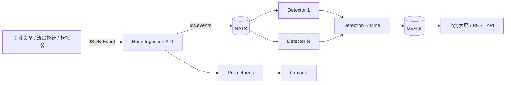

# go-ditecting

> 面向工业控制网络的安全监测、异常检测与告警处置平台。

[](https://go.dev/)
[](https://www.cloudwego.io/zh/docs/hertz/)
[](.github/workflows/ci.yml)
[](LICENSE)

Go-Ditecting 为东北大学谛听网络安全实验室的成员赵明杰的个人项目。它接收来自 PLC、HMI、工程师站和 SCADA 的结构化安全事件，通过 NATS 异步检测，完成资产自动发现、异常识别、告警聚合与事件处置。

## 项目特色

- **完整业务闭环**：事件接入 → 规则检测 → 告警聚合 → 分析员研判 → 事件闭环；
- **事件驱动架构**：API 与检测器通过 NATS 解耦，Detector 使用队列组支持水平扩展；
- **工业安全语义**：内置 Modbus 非法写入、异常时段控制、认证爆破、OT 端口扫描和工艺参数越界规则；
- **双运行模式**：本地单进程零依赖演示，Docker Compose 分布式部署；
- **工程化**：结构化日志、Prometheus 指标、Grafana 面板、健康检查、CI、单元测试和 OpenAPI 文档；
- **安全基线**：签名令牌、独立采集密钥、输入校验、CORS 白名单和安全响应头。

## 架构



Detector 实例加入同一个 `diting-detectors` queue group。一条事件只会交给其中一个实例处理；告警使用 `规则 + 资产 + 来源` 生成稳定指纹，并在 15 分钟窗口内聚合，避免告警风暴。

## 快速体验

只需要 安装Go 1.23，无需安装 MySQL 或 NATS：

```bash
go run ./cmd/api
```

打开 <http://localhost:8080>，使用演示账号：

```text
账号：analyst
密码：diting2026
```

进入系统后点击右上角“模拟攻击流量”，即可看到 15 条事件经过检测后形成 5 类告警。单进程模式使用内存存储，重启后数据清空，适合个人主页录屏和面试演示。

## 完整分布式启动

```bash
docker compose up --build -d
```

| 服务 | 地址 | 说明 |
|---|---|---|
| Diting-ICS | <http://localhost:8080> | 态势大屏与 API |
| Grafana | <http://localhost:3000> | `admin / diting-grafana` |
| Prometheus | <http://localhost:9090> | 服务指标 |
| NATS Monitor | <http://localhost:8222> | 消息系统状态 |

生产环境必须通过 `.env` 修改 `JWT_SECRET`、演示账号密码、采集密钥和数据库口令。

## 检测规则

| 规则 | 检测逻辑 | 严重度 | ATT&CK for ICS |
|---|---|---:|---|
| `ICS-MODBUS-001` | 未授权源执行 FC 5/6/15/16 | 严重 | T0855 |
| `ICS-TIME-002` | 维护时间窗外执行控制写入 | 高危 | T0855 |
| `ICS-AUTH-003` | 60 秒内连续认证失败 5 次 | 高危 | T0806 |
| `ICS-DISCOVERY-004` | 20 秒内探测 8 个目标端口 | 中危 | T0846 |
| `ICS-PROCESS-005` | 工艺遥测值越过预设上下限 | 高危 | T0836 |

有状态规则采用互斥保护的滑动时间窗口；规则引擎与 Web、消息系统、数据库完全解耦，因此可以独立测试，也可以继续扩展 YAML/DSL 规则。

## API 示例

采集器通过单独的 `X-Ingest-Key` 写入事件，不复用分析员令牌：

```bash
curl -X POST http://localhost:8080/api/v1/events \
  -H "Content-Type: application/json" \
  -H "X-Ingest-Key: diting-ingest-key" \
  -d '{
    "asset_ip": "10.20.1.11",
    "asset_name": "PLC-1 灌装控制器",
    "asset_type": "PLC",
    "zone": "生产一区",
    "source_ip": "172.16.8.66",
    "protocol": "modbus",
    "event_type": "control",
    "action": "write_register",
    "function_code": 16,
    "register_address": 40001,
    "authorized": false
  }'
```

完整接口见 [`api/openapi.yaml`](api/openapi.yaml)。

## 工程目录

```text
cmd/
├── api/          HTTP 接入、查询与 Web 大屏
├── detector/     NATS 消费与规则检测
└── simulator/    工业遥测与攻击事件模拟器
internal/
├── auth/         HMAC 签名令牌
├── bus/          内存 / NATS 消息总线
├── detection/    可组合的检测规则引擎
├── domain/       资产、事件、告警和事件单模型
├── httpapi/      Hertz 路由与嵌入式前端
├── platform/     应用编排层
└── store/        内存 / MySQL 数据访问层
deploy/           Prometheus 与 Grafana 配置
```

## 测试与质量检查

```bash
go test ./...
go test -race -coverprofile=coverage.out ./...
go vet ./...
```

测试重点覆盖规则命中/放行、滑动窗口阈值、令牌签发校验和告警聚合。GitHub Actions 会执行格式检查、静态检查、竞态检测、覆盖率采集和三入口构建。

## 安全说明

本项目只生成结构化模拟事件，不执行端口扫描、漏洞利用或 PLC 控制。不要把主动探测代码直接接入生产 OT 网络；真实环境部署前应经过资产所有者授权、变更评审和安全测试。

## 路线图

- JetStream 持久化消费、重试和死信队列；
- PostgreSQL/MySQL Outbox，保证事件与业务状态一致性；
- Casbin RBAC 与多租户隔离；
- Sigma 风格规则 DSL 和热更新；
- WebSocket/SSE 实时告警推送；
- PCAP 特征提取器与脱敏数据回放。

## 来源与许可

本项目受 [CloudWeGo biz-demo/gomall](https://github.com/cloudwego/biz-demo/tree/main/gomall) 启发并在其 Apache-2.0 授权基础上进行领域重构。详见 [`NOTICE`](NOTICE) 与 [`LICENSE`](LICENSE)。

